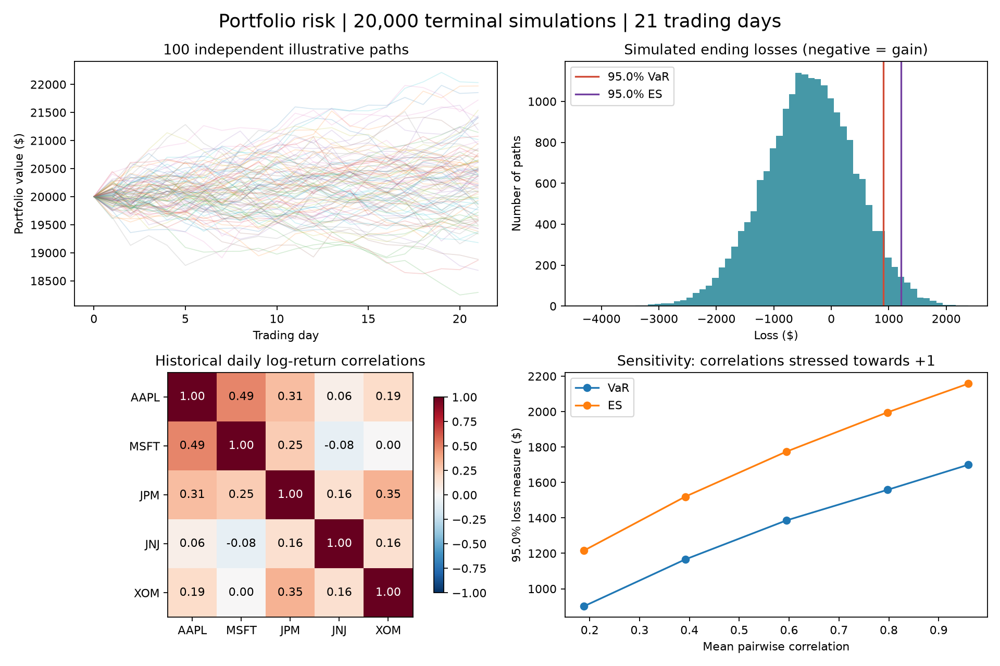

# Learn Monte Carlo portfolio risk

The question: **If I start with $20,000 spread across five stocks, what range of values could my portfolio have after 21 trading days, under a model fitted to historical data?**

This project uses AAPL, MSFT, JPM, JNJ, and XOM as examples, with 20% ($4,000) initially in each stock. These are learning examples, not investment recommendations. The default historical window is January 2023 through December 2025: three completed calendar years. It does not use live prices.

Defaults: 20,000 simulations, $20,000 initial investment, seed 10, 21 trading days, and 20% in each stock. The seed matches the saved older simulator; the new sampler still generates different draws, so its results can change.

## Run it

Open this `portfolio-risk` folder in VS Code (File > Open Folder). Open Terminal > New Terminal. For a fresh download of this repository, follow the installation commands below first.

```powershell
.\.venv\Scripts\python.exe portfolio_risk.py --cached
```

The cached command reuses the downloaded prices. To download them again, omit `--cached`. The results folder is overwritten on each run. Open `results/REPORT.md` for numbers and `results/dashboard.png` for charts. The included VS Code launch configuration also runs the cached version. Use `--output results/my-experiment` to keep a separate run.

On a new computer, install Python, then run these commands inside the project folder:

```powershell
python -m venv .venv
.\.venv\Scripts\python.exe -m pip install -r requirements.txt
.\.venv\Scripts\python.exe portfolio_risk.py
```

## Example output



See [the example report](examples/REPORT.md) for the corresponding settings and results. Downloaded prices and generated run files are excluded from Git.

## Improved version: speed, tail calculations, and model comparison

```powershell
# Compare normal log returns with resampled blocks of historical days
.\.venv\Scripts\python.exe portfolio_risk.py --cached --compare-historical

# A more extreme tail, with more simulations and a separate output folder
.\.venv\Scripts\python.exe portfolio_risk.py --cached --confidence .99 --paths 100000 --compare-historical --output results/99-percent
```

- **Speed:** `simulate_terminal()` draws ending values directly. Under the independent normal-log-return assumption, 21 daily log returns sum to a normal variable with mean `21 * mu` and volatility `sqrt(21) * sigma`. We only generate 100 daily paths for illustration. The shortcut is exact for this model's terminal buy-and-hold distribution; it cannot compute maximum drawdowns or daily rebalancing outcomes.
- **Tail calculation:** `risk()` uses empirical inverse-CDF VaR and averages exactly the worst tail probability mass for ES. A fractional boundary observation is weighted appropriately. Repeated losses at the threshold no longer cause ES to include too much of the sample.
- **Confidence:** `--confidence .95` examines the worst 5%, while `.99` examines the worst 1%. The report warns when there are fewer than 100 effective tail observations. This is a useful caution threshold, not a statistical guarantee.
- **Simulation uncertainty:** 200 percentile-bootstrap resamples of simulated outcomes provide approximate 95% intervals around VaR and ES. These measure **Monte Carlo sampling noise only**, conditional on fitted inputs. They exclude uncertainty in historical estimates and model assumptions. `--resamples 1000` improves the stability of interval endpoints; `--resamples 0` skips this work. The interval's 95% coverage level is separate from your chosen VaR/ES level.
- **Alternative model:** `--compare-historical` samples five-day contiguous blocks of observed log returns. All stocks use the same selected days, preserving within-day relationships and some short-term patterns. `--block-days 1` selects independent days. Blocks do not wrap at the end of the dataset. Block boundaries break dependence; five days is a starting assumption, not an optimized choice. Unseen daily shocks cannot be generated from this finite history. A higher ES does not prove a model is more accurate.
- **Reproducibility:** separate random streams mean changing plots, resample counts, or enabling the historical comparison does not alter the Gaussian point estimates. The new sampler changes the draws compared with version 1, so the same seed no longer produces the original $452/$592 estimates. The quantile convention also changed slightly. This is not evidence of a change in underlying portfolio risk.

`model_comparison.png` shows the estimates with Monte Carlo uncertainty ranges. `model_comparison.csv` stores their numbers. Correlation stress scenarios still apply to the Gaussian model only. Changing block length or running more simulations does not constitute out-of-sample validation.

CSV risk columns are now `VaR_dollars`, `ES_dollars`, `VaR_fraction`, and `ES_fraction`, with an explicit `confidence` column, instead of names hard-coded to 95%.

Benchmark with `.\.venv\Scripts\python.exe benchmark.py`. It reports median time over five repetitions and traced peak allocations for one scenario, including random generation. It excludes chart rendering, file operations, uncertainty intervals, and the historical model; it is not an end-to-end speed claim. On the development machine, the 10,000-outcome/21-day/five-stock kernel ran about 31 times faster, with traced peak allocations falling from about 40 MiB to 1.2 MiB. Your timing may differ.

## Learn in this order

### 1. A return is a percentage change

A price moving from $100 to $103 gives a simple return of `103 / 100 - 1 = 0.03`, or 3%. A $2,000 holding becomes $2,060. Returns let us compare stocks with different share prices.

In `estimate()`, `prices.pct_change()` calculates this for every stock and day. The average daily return describes the historical average; the standard deviation measures how much daily returns varied. A larger standard deviation means greater volatility.

Annualized arithmetic mean = daily mean times 252. Annualized volatility = daily standard deviation times square root of 252, assuming independent daily returns with stable variance. These annualized figures are summaries; the simulation uses daily inputs. The annualized arithmetic mean is not the compounded return you actually earned.

**Try first:** Calculate returns for prices 100, 110, 99. The daily returns are +10% and -10%, but the overall return is -1%. This is why we compound returns instead of just adding percentages.

### 2. Log returns make compounding convenient

The simulation uses `log(today / yesterday)`. Log returns add across days. To convert the accumulated log return back into a growth multiplier, use `exp(sum_of_log_returns)`.

We estimate the mean and standard deviation of historical log returns directly. Consequently, we do not subtract another half-variance adjustment from that estimated log mean.

Read `estimate()` and compare its simple-return and log-return calculations. Both start from the same adjusted prices.

### 3. Correlation links the stocks

Correlation measures whether returns tend to move together. Near +1 means strongly together; near 0 means little linear relationship; near -1 means strongly opposite. Zero correlation does not generally mean independence.

If all your stocks fall together, holding five names may provide little protection. Risk depends on **weights, individual volatilities, and correlations**, not correlation alone.

`logs.corr()` estimates the correlation matrix. Cholesky decomposition produces a matrix `L` such that `L @ L.T` equals that correlation matrix. Multiplying independent standard normal draws by `L.T` gives shocks with the desired correlations in the model. A finite sample will only approximate those correlations.

Read these lines in `simulate()`:

```python
factor = np.linalg.cholesky(correlation)
correlated = shocks @ factor.T
daily_log_returns = mu + correlated * sigma
```

`mu` is each stock's daily log mean. `sigma` is its daily log volatility. The random part supplies the day's surprise. This is a modeling assumption, not a prediction of tomorrow's return.

### 4. Simulate many possible months

The fast risk calculation uses random draws of shape `(20000, 5)`: one month's aggregate shock per stock and future. `simulate_terminal()` scales the mean by 21 and volatility by the square root of 21. It compounds each stock before adding the holdings. Starting weights are equal, but they drift as stocks move: this is buy and hold, not daily rebalancing.

The original `simulate()` function remains for learning, mathematical tests, and the 100 illustrative daily paths, using shape `(100, 21, 5)`. Those paths are a separate random sample, not the first 100 terminal outcomes used for VaR and ES.

The seed makes random draws reproducible. Changing it produces a different sample from the same model; it does not change the underlying assumptions.

### 5. Turn ending values into losses

`loss = starting_value - ending_value`. An ending value of $9,400 means a $600 loss; $10,600 means a negative $600 loss (a gain).

For 10,000 paths, the worst 5% is approximately 500 outcomes:

- **95% VaR:** the loss threshold exceeded in approximately 5% of simulated outcomes.
- **95% Expected Shortfall (ES):** the average loss in that worst 5% tail.

For example, a hypothetical VaR of $700 and ES of $950 means about 5% of modeled months lose more than $700, and the worst 5% probability mass has an average loss of $950. Neither number is a maximum possible loss. Read `risk()` in `risk_engine.py` to connect these definitions to the code. With tied observations, fewer than 5% may strictly exceed VaR. ES still averages exactly 5% probability mass, fractionally weighting the boundary as needed.

### 6. Change one assumption

`stress_correlation()` moves all off-diagonal correlations toward +1 while preserving a valid correlation matrix. Stress strength 0.5 means halfway from the historical matrix to perfect positive correlation; it does not mean every correlation becomes 0.5.

The scenarios reuse the same random draws and keep stock means and volatilities fixed. This makes their differences easier to attribute to correlation. The stress experiment describes a hypothetical change, not a prediction that correlations will rise.

## Small experiments to do yourself

Run each command, then read the report before proceeding:

```powershell
# Same assumptions, different random sample
.\.venv\Scripts\python.exe portfolio_risk.py --cached --seed 7

# More paths: reduce simulation sampling noise, not model error
.\.venv\Scripts\python.exe portfolio_risk.py --cached --paths 50000

# Double the default starting amount: dollar VaR and ES should double
.\.venv\Scripts\python.exe portfolio_risk.py --cached --initial 40000

# Concentrate 60% in the first stock; keep the total at 100%
.\.venv\Scripts\python.exe portfolio_risk.py --cached --weights .6 .1 .1 .1 .1
```

Before running each experiment, write down what you expect and why. Afterwards, explain any difference. Do not choose weights merely because they look best in the same historical sample.

## Files and checks

- `portfolio_risk.py`: data loading, settings, experiment orchestration, and charts.
- `data/`: downloaded, aligned adjusted closes; cached data permits offline runs.
- `results/parameters.csv`: estimated daily and annualized statistics, in decimal units.
- `results/correlation.csv`: historical log-return correlations.
- `results/daily_log_returns.csv`: inputs used to estimate the model.
- `results/simulated_outcomes.csv`: all terminal values, returns, and losses.
- `results/example_paths.csv`: 100 independently sampled illustrative paths, not used for the reported risk estimates.
- `results/sensitivity.csv`: results for each correlation stress.
- `results/settings.json`: parameters and data dates for the latest run.
- `results/REPORT.md` and `results/dashboard.png`: readable summary and charts.
- `results/model_comparison.csv` and `results/model_comparison.png`: model estimates and optional MC intervals.
- `risk_engine.py`: terminal samplers, VaR/ES calculations, and Monte Carlo intervals.
- `benchmark.py`: reproducible timing/memory comparison of daily and terminal Gaussian simulation.

Run checks with `.\.venv\Scripts\python.exe -m unittest -v`. The 12 tests include known and tied loss tails, fractional ES boundaries, 99% confidence, invalid inputs, compounding, an analytic single-stock lognormal VaR/ES benchmark, equality with the original daily sampler using matched shocks, joint historical sampling, interval reproducibility/scaling, generated correlations, and valid stressed matrices.

The Gaussian model assumes independent daily normal log returns and stable parameters. Real markets can have heavier tails, changing volatility, and changing correlations. Historical mean returns are noisy. More simulations cannot fix these assumptions. The historical comparison is now implemented; the most important next extension is evaluating both models' risk estimates on later, unseen data using only information available at each forecast date. Until then, neither model is claimed to be empirically validated.

## Documentation

- [yfinance download arguments](https://ranaroussi.github.io/yfinance/reference/api/yfinance.download.html): adjusted prices are explicitly enabled and the end date is exclusive.
- [NumPy normal random draws](https://numpy.org/doc/stable/reference/random/generated/numpy.random.Generator.standard_normal.html).
- [NumPy quantile conventions](https://numpy.org/doc/stable/reference/generated/numpy.quantile.html): the empirical inverse CDF differs from the previous linear interpolation convention.

This is an original learning implementation; no third-party repository code was copied.
